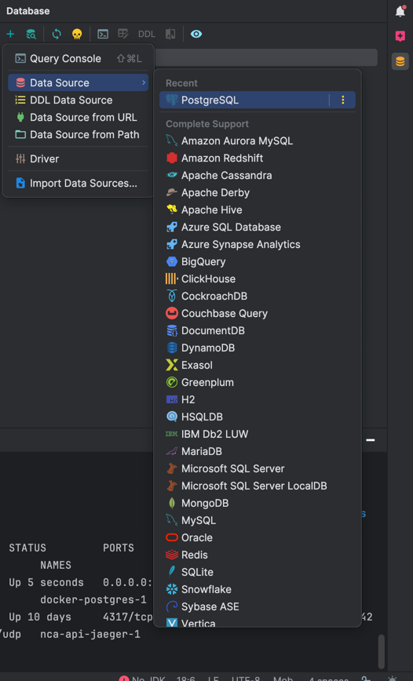
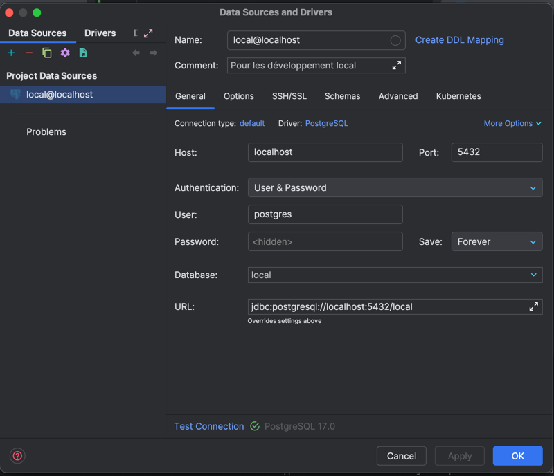

# Guide de développement

Tout ce qu'il faut pour lancer, tester et déployer le projet. La vue d'ensemble est dans le
[README](README.md).

## Sommaire

1. [Prérequis](#prérequis)
2. [Configuration](#configuration)
3. [Lancer en développement](#lancer-en-développement)
4. [Données de test](#données-de-test)
5. [Tests](#tests)
6. [Production](#production)
7. [Conventions du code](#conventions-du-code)
8. [Dépannage](#dépannage)

## Prérequis

| Outil | Version |
|---|---|
| Java (JDK) | 21 ou plus |
| Node.js | 20.19 ou plus (22 / 24 conseillés) |
| npm | 10 ou plus |
| Docker + Docker Compose | récent |

Maven n'a pas besoin d'être installé : le wrapper `./mvnw` est fourni.

## Configuration

Le backend lit ses réglages dans des variables d'environnement. En local, le plus simple est un
fichier `.env` à la racine du dépôt :

```bash
cp .env.example .env
```

| Variable | Défaut | Rôle |
|---|---|---|
| `DB_URL` | `jdbc:postgresql://localhost:5432/local` | URL JDBC PostgreSQL |
| `DB_USERNAME` | `postgres` | Utilisateur de la base |
| `DB_PASSWORD` | `postgres` | Mot de passe de la base |
| `DB_JPA_DDL_AUTO` | `create-drop` | Gestion du schéma (`create-drop`, `update`, `validate`, `none`) |
| `ORS_KEY` | — | Clé de l'API [OpenRouteService](https://openrouteservice.org/dev/#/signup) (gratuite) |

> ⚠️ Le fichier `.env` est ignoré par git. Ne jamais committer de vraie clé ni de mot de passe.

Avec `create-drop`, la base est **vidée à chaque redémarrage** du backend. Utiliser `update` pour
garder les données entre deux lancements.

## Lancer en développement

Trois processus séparés, chacun dans son terminal.

### 1. PostgreSQL

```bash
docker compose -f docker-compose-local.yml up -d postgres
```

Base `local` sur `localhost:5432`, utilisateur `postgres`, mot de passe `postgres`.

Pour l'arrêter : `docker compose -f docker-compose-local.yml down`.

Pour consulter les données depuis IntelliJ, ajouter une *data source* PostgreSQL avec ces
paramètres :




### 2. Backend

```bash
./mvnw clean install -DskipTests              # une fois, compile tous les modules
./mvnw -f backend/pom.xml -pl server spring-boot:run
```

- API : http://localhost:8080/api
- Swagger UI : http://localhost:8080/swagger-ui/index.html

### 3. Frontend

```bash
cd client
npm ci
npm start
```

Application : http://localhost:4200

`npm start` utilise [client/proxy.conf.json](client/proxy.conf.json). Le serveur de dev Angular
redirige `/api` et `/ws` vers `localhost:8080`, ce qui évite les problèmes de CORS. Le code
frontend n'utilise donc que des URL relatives (`/api/...`).

## Données de test

Après un démarrage sur une base vide, importer un jeu de données :

```bash
curl -X POST http://localhost:8080/api/data/import \
  -H "Content-Type: application/json" \
  -d '{"dataset": "dataset-100-par-3-exemple-1", "clearBeforeImport": true}'
```

Jeux disponibles (dans `backend/server/src/main/resources/datasets/`) :

| Nom | Adresses (environ) | Véhicules suggérés |
|---|---|---|
| `dataset-50-par-3-exemple-1` à `-3` | 50 | 3 |
| `dataset-100-par-3-exemple-1` à `-2` | 100 | 3 |
| `dataset-400-par-10-exemple-1` à `-2` | 400 | 10 |

L'import lui-même n'appelle aucune API externe. En revanche, **l'optimisation interroge
OpenRouteService** pour les matrices de distances et de durées : une `ORS_KEY` valide est
nécessaire. Les gros jeux consomment beaucoup de quota (requêtes découpées en blocs de 50×50).
Les quotas de l'offre gratuite sont listés dans
[docs/limites-openrouteservice.md](docs/limites-openrouteservice.md).

Pour ajouter des livraisons aléatoires :

```bash
curl -X POST http://localhost:8080/api/data/generate/livraisons \
  -H "Content-Type: application/json" -d '{"count": 20}'
```

## Tests

### Backend

```bash
./mvnw -f backend/pom.xml clean verify                                   # tout + couverture
./mvnw -f backend/pom.xml -pl server test -Dtest=ParkingEndpointsTest     # une classe
./mvnw -f backend/pom.xml -pl server test -Dtest='!SolutionGenerationEndpointsTest'  # sans le test lent
```

- Base H2 en mémoire, configurée dans `backend/server/src/test/resources/application.yml`.
- OpenRouteService est **toujours simulé** : aucune clé ni connexion réseau n'est nécessaire.
- `verify` échoue si la couverture de lignes JaCoCo n'est pas de **100 %** (règle dans
  `backend/pom.xml`). Les classes annotées `@Generated` sont exclues du calcul.

### Frontend

```bash
cd client
npm test -- --watch=false --browsers=ChromeHeadless
```

Karma a besoin de Chrome ou Chromium. S'il n'est pas trouvé, indiquer son chemin dans la variable
`CHROME_BIN`.

## Production

L'image Docker unique contient le frontend compilé et le backend Spring Boot. La base PostgreSQL
est externe (service managé).

```bash
docker build -t cybercommandes:latest .

docker run -p 8080:8080 \
  -e DB_URL="jdbc:postgresql://<hote>:5432/<base>" \
  -e DB_USERNAME="<utilisateur>" \
  -e DB_PASSWORD="<mot-de-passe>" \
  -e DB_JPA_DDL_AUTO="validate" \
  -e ORS_KEY="<cle-ors>" \
  cybercommandes:latest
```

Application : http://localhost:8080

Autres fichiers de déploiement :

- `docker-compose.yml` : application + PostgreSQL sur un même serveur.
- `deploy/` : redéploiement automatique par systemd, voir [deploy/README.md](deploy/README.md).
- `OpenRouteService/` : instance ORS auto-hébergée, voir [OpenRouteService/SETUP.md](OpenRouteService/SETUP.md).
- CI : [.github/CI-CD.md](.github/CI-CD.md).

## Conventions du code

### Architecture backend

- `backend/rest-api` contient **uniquement** les contrats : interfaces d'endpoints (`endpoints/`)
  et DTO immuables (`record`). Aucune logique.
- `backend/server` implémente ces interfaces. Les contrôleurs délèguent aux services ; les
  conversions entité ↔ DTO passent par MapStruct (`mappers/`).
- Un nouvel endpoint commence par son interface dans `rest-api`, puis son test MockMvc dans
  `server/src/test/.../endpoints/`, puis l'implémentation.

### Contrat frontend ↔ backend

- Chaque DTO Java a son schéma **Zod** miroir dans `client/src/app/models/backend.ts`, avec les
  mêmes noms de champs (`XxxResponseDTO` → `XxxResponseSchema`).
- Tous les appels HTTP passent par `client/src/app/services/BackendApiService.ts`, et chaque
  réponse est validée avec son schéma Zod.
- Les matrices OpenRouteService restent côté serveur.

### Style

- Java : conventions Oracle (voir aussi [.editorconfig](.editorconfig)).
- TypeScript : Prettier (`printWidth: 100`, `singleQuote: true`), composants standalone,
  `ChangeDetectionStrategy.OnPush`, signals.

### Git

- Une branche par tâche : `task/<id>-<description-courte>`.
- Messages de commit : `feat(#<id>): ...`, `fix(#<id>): ...`, `test(#<id>): ...`, `docs: ...`.

## Dépannage

| Symptôme | Cause probable | Solution |
|---|---|---|
| `TypeTag :: UNKNOWN` à la compilation | Lombok trop ancien pour votre JDK | Lombok est en 1.18.42 (JDK 21 à 25) ; mettre à jour si JDK plus récent |
| `Connection refused` sur le port 5432 | PostgreSQL non démarré | Lancer Docker Desktop, puis `docker compose ... up -d postgres` |
| `Port 8080 was already in use` | Un autre programme utilise le port | Lancer avec `SERVER_PORT=8081` et adapter `client/proxy.conf.json` |
| L'optimisation reste bloquée ou échoue | Clé `ORS_KEY` absente ou quota dépassé | Vérifier la clé ; tester d'abord avec un jeu de 50 adresses |
| La base est vide après redémarrage | `DB_JPA_DDL_AUTO=create-drop` | Passer à `update` ou réimporter un jeu de données |
| `Cannot start ChromeHeadless` | Chrome non installé | Installer Chrome ou définir `CHROME_BIN` |
