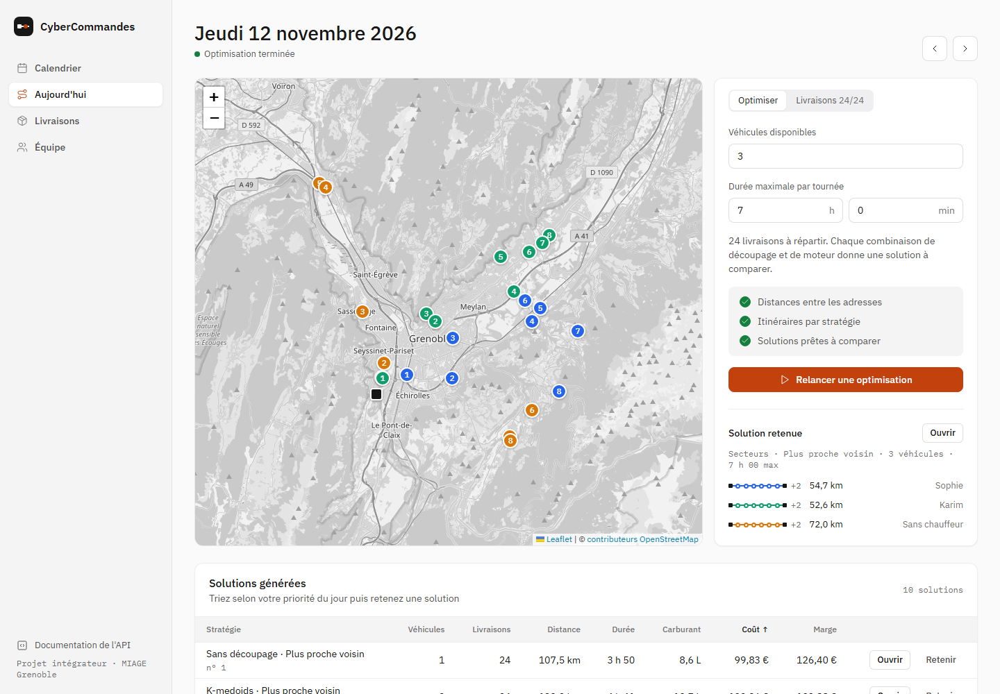
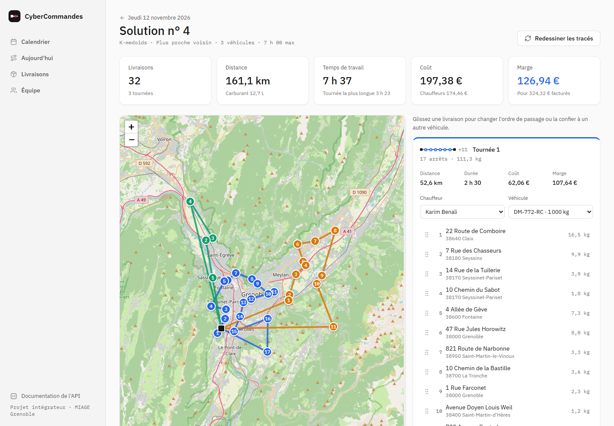
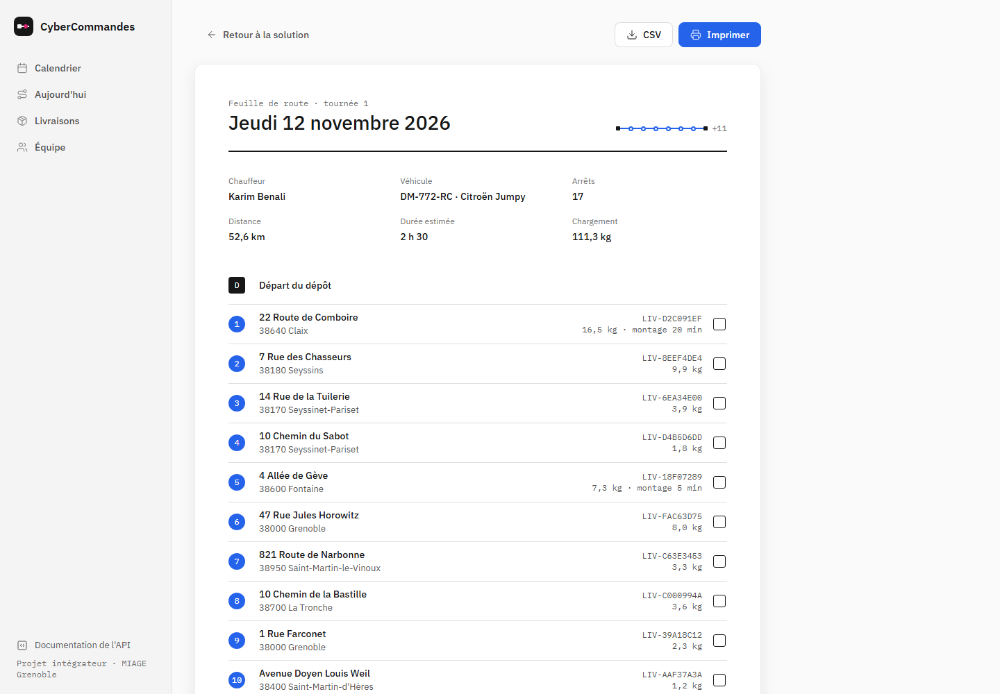
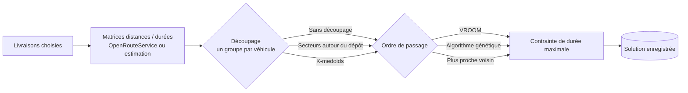
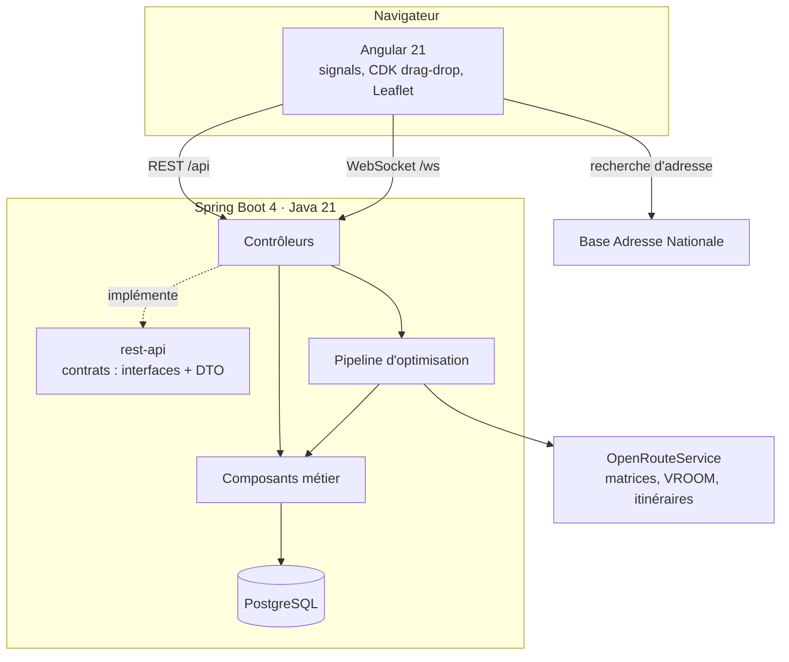

# CyberCommandes

**Préparer en quelques minutes les tournées de livraison d'une journée.**

CyberCommandes aide un planificateur d'entrepôt à répartir les colis du jour entre ses
véhicules. L'application calcule plusieurs plans de tournées, les compare en distance, en temps
et en coût, puis laisse le planificateur ajuster le plan retenu à la main avant d'imprimer les
feuilles de route des chauffeurs.



> Projet intégrateur de L3 MIAGE à l'Université Grenoble Alpes (2025-2026), réalisé à six,
> puis repris et étendu seul par Mohamed Amine Jaanane en M1 MIAGE. Le détail est dans
> [Historique du projet](#historique-du-projet).

## Sommaire

- [Ce que fait l'application](#ce-que-fait-lapplication)
- [Démarrer en deux minutes](#démarrer-en-deux-minutes)
- [Comment fonctionne l'optimisation](#comment-fonctionne-loptimisation)
- [Architecture](#architecture)
- [Qualité et tests](#qualité-et-tests)
- [Historique du projet](#historique-du-projet)
- [Documentation](#documentation)

## Ce que fait l'application

| Étape | Ce que fait le planificateur |
|---|---|
| **Préparer** | Gère les livraisons (adresse recherchée dans la Base Adresse Nationale, poids, temps de montage) et l'équipe (chauffeurs et véhicules avec photo, charge utile, consommation). |
| **Optimiser** | Choisit le nombre de véhicules et la durée maximale d'une tournée. L'application génère une solution par stratégie (31 pour 5 véhicules) en arrière-plan et affiche l'avancement en direct. |
| **Comparer** | Trie les solutions par distance, durée, carburant, coût ou marge, puis retient la meilleure pour la journée. |
| **Ajuster** | Déplace des livraisons d'une tournée à l'autre par glisser-déposer. Distances, coûts et tracés sont recalculés. |
| **Affecter** | Confie chaque tournée à un chauffeur et à un véhicule. Un même chauffeur ne peut pas conduire deux tournées, et un chargement trop lourd est refusé. |
| **Livrer** | Imprime la feuille de route ou l'exporte en CSV, puis clôture la tournée : ses livraisons passent à « livrée ». |

Une **page d'accueil** présente l'application. Le **calendrier** montre les journées déjà optimisées
et celles dont la solution est retenue.

<table>
  <tr>
    <td></td>
    <td></td>
  </tr>
  <tr>
    <td align="center">Éditeur de solution</td>
    <td align="center">Feuille de route du chauffeur</td>
  </tr>
</table>

### Coût et marge

Chaque tournée affiche son bilan :

- **Coût** = carburant (distance × consommation du véhicule × prix du litre) + heures payées au
  chauffeur (trajet et montage, au taux horaire du chauffeur affecté).
- **Recette** = forfait par livraison + supplément au kilogramme.

Les valeurs par défaut se règlent dans
[`application.yml`](backend/server/src/main/resources/application.yml) (`app.couts`).

## Démarrer en deux minutes

Seul **Docker** est nécessaire. Aucune clé d'API n'est requise.

```bash
git clone https://github.com/MEDAMINEJAANANE21/pi-2025-2026-groupe-7.git
cd pi-2025-2026-groupe-7
docker compose -f docker-compose-local.yml --profile app up --build
```

Ouvrez http://localhost:8080. Dans **Livraisons**, cliquez sur **Jeu d'essai** : 32 livraisons autour
de Grenoble, 6 chauffeurs et 5 véhicules sont chargés. Ouvrez ensuite **Aujourd'hui** et lancez
l'optimisation.

> **Sans clé OpenRouteService**, l'application passe en *mode estimation* : les distances sont
> calculées à vol d'oiseau (avec un facteur de détour), et le moteur VROOM n'est pas proposé.
> Pour de vrais itinéraires routiers, créez une clé gratuite sur
> [openrouteservice.org](https://openrouteservice.org/dev/#/signup) et passez-la dans `ORS_KEY`.

Pour développer (rechargement à chaud, tests), suivez le [guide de développement](DEVELOPMENT.md).

## Comment fonctionne l'optimisation

Répartir des colis entre véhicules est un problème de tournées de véhicules (VRP). Il est trop
coûteux à résoudre exactement : on combine donc deux étapes approchées.



1. **Découpage.** Les livraisons sont réparties en groupes, un par véhicule. On peut prendre des
   secteurs angulaires autour du dépôt, comme des parts de gâteau, ou faire des groupes de
   voisins avec K-medoids. On peut aussi laisser VROOM tout répartir lui-même.
2. **Ordre de passage.** Chaque groupe est ordonné par VROOM (solveur d'OpenRouteService), par
   un algorithme génétique (Jenetics) ou par l'heuristique du plus proche voisin.
3. **Durée maximale.** Si une tournée dépasse le budget de temps, on retire d'abord la commande
   la plus récente : les clients qui attendent depuis longtemps restent prioritaires.

Chaque combinaison découpage × moteur × nombre de véhicules donne une solution. Les calculs
tournent en parallèle sur un pool de threads dédié. Le navigateur suit l'avancement par
WebSocket (STOMP).

## Architecture



| Partie | Technologies |
|---|---|
| Frontend | Angular 21 (composants standalone, signals, zoneless), Angular CDK, Leaflet, Zod, STOMP |
| Backend | Java 21, Spring Boot 4, Spring Data JPA, MapStruct, Lombok, Jenetics, Resilience4j, springdoc-openapi |
| Données | PostgreSQL ; H2 en mémoire pour les tests |
| Qualité | JUnit 5, AssertJ, Mockito, WebTestClient, JaCoCo · Jasmine, Karma |
| Livraison | Docker multi-étapes, GitHub Actions |

Patterns utilisés et choix techniques : voir [docs/architecture.md](docs/architecture.md).

```text
backend/rest-api   contrats publics de l'API (interfaces d'endpoints, DTO), sans logique
backend/server     contrôleurs, composants métier, optimisation, persistance
client/            application Angular
docs/              architecture, API, fonctionnalités, rapport technique de L3
deploy/, nginx/    déploiement sur serveur ; OpenRouteService/ pour un ORS auto-hébergé
```

## Qualité et tests

```bash
./mvnw -f backend/pom.xml verify     # tests backend + seuil de couverture JaCoCo
cd client && npm run test:ci         # tests frontend (Chrome headless)
```

- **Backend** : tests unitaires des algorithmes (découpage, glouton, génétique, contrainte de
  durée, coûts), et tests d'intégration de chaque route sur une base H2. OpenRouteService est
  toujours simulé : aucune clé ni connexion n'est nécessaire.
- **Couverture** mesurée et **bloquante** : au moins 85 % des lignes et 65 % des branches.
- **Frontend** : utilitaires, couche API (HttpTestingController), éditeur de tournées et
  composants clés.
- **CI** : chaque push lance les deux suites, puis construit l'image Docker sur `main`.

## Historique du projet

**L3 MIAGE, 2025-2026 : projet intégrateur en groupe.** Nikolai Dorofeev, Omar Barkok, Mohamed
Amine Cheikh, Maxime Legrenzi, Tennessee Alves et Mohamed Amine Jaanane ont construit la
première version. Elle s'appuyait sur une base fournie par Alexandre Demeure et Nicolas Marinho
([sujet](https://github.com/L3-MIAGE-GRENOBLE/l3m-CyberCommandes-2025-2026)). Elle couvrait
déjà l'optimisation en deux phases, la comparaison des solutions et l'édition par
glisser-déposer. Le [rapport technique d'origine](docs/rapport-technique.md) décrit cette version.

**M1 MIAGE : reprise par Mohamed Amine Jaanane.**

- *Architecture* :
  - le service d'optimisation de 470 lignes a été découpé en classes à responsabilité unique
    (Strategy pour les moteurs et les découpages, Factory pour le problème) ;
  - exceptions métier plutôt qu'exceptions HTTP dans les services ;
  - pool de threads dédié, sans attente bloquante ;
  - code mort et dépendances inutilisées supprimés.
- *Corrections* :
  - avec un découpage, chaque groupe recevait tous les véhicules au lieu d'un seul ;
  - recharger une page profonde donnait une erreur 404 en production ;
  - une optimisation interrompue par un redémarrage bloquait la journée pour toujours ;
  - le seuil de couverture n'était en réalité jamais vérifié.
- *Fonctionnalités* : page d'accueil, saisie et modification des livraisons, équipe avec photos, affectation
  des tournées, coûts et marges, clôture des tournées, feuille de route imprimable et export CSV,
  calendrier, jeu d'essai en un clic, mode estimation sans clé d'API.
- *Interface* : refonte complète. Un design system sobre remplace Taiga UI, et le bundle
  initial passe sous 90 ko compressés.
- *Tests* : tests unitaires des algorithmes, tests de toutes les nouvelles routes, couverture
  rendue bloquante.

## Documentation

| Document | Contenu |
|---|---|
| [DEVELOPMENT.md](DEVELOPMENT.md) | Installation, configuration, tests, production, dépannage |
| [docs/architecture.md](docs/architecture.md) | Couches, patterns, pipeline d'optimisation, modèle de données, choix techniques |
| [docs/api.md](docs/api.md) | Toutes les routes REST et le sujet WebSocket |
| [docs/fonctionnalites.md](docs/fonctionnalites.md) | Besoins de départ et état de chacun |
| [docs/processes.md](docs/processes.md) | Processus métier du planificateur |
| [docs/rapport-technique.md](docs/rapport-technique.md) | Rapport technique de la version L3 |

La documentation interactive de l'API est servie par le backend sur `/swagger-ui/index.html`.

## Licence

[MIT](LICENSE). Contributeurs : voir [AUTHORS](AUTHORS).
