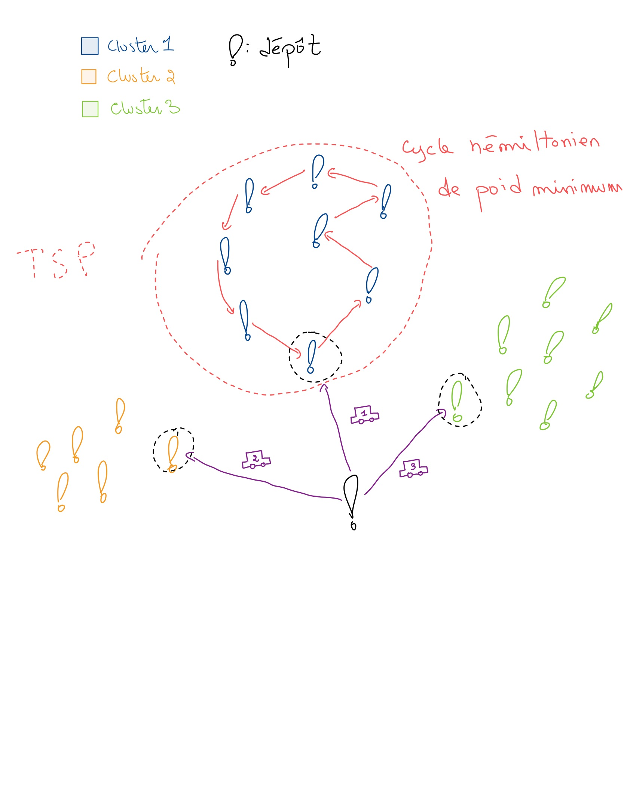

# Rapport technique

Ce document explique les choix techniques du projet : organisation, données, algorithmes
d'optimisation et éditeur de solution. Pour installer et lancer le projet, voir le
[README](../README.md) et le [guide de développement](../DEVELOPMENT.md).

- Bibliothèque UI : [Taiga UI](https://taiga-ui.dev/)
- Démo (déploiement du groupe) : https://l3miage-projet-integrateur-g7.onrender.com/

## Organisation du Projet

### Workflow de Développement

Le projet utilise une approche collaborative basée sur **GitHub** :

- **Branches & Pull Requests** : Chaque nouvelle fonctionnalité est développée dans une branche dédiée (ex: `feature/nouvelle-fonctionnalite`), puis intégrée via une Pull Request vers la branche `main`
- **Code Review** : Les PRs sont revues par les membres de l'équipe avant fusion
- **Task Tracking** : Un tableau GitHub Projects a été utilisé pour gérer les tâches, suivre l'avancement et organiser le backlog

### CI/CD avec GitHub Actions

Le frontend bénéficie d'une intégration continue automatisée via **GitHub Actions** :

**Workflows CI** :

1. **[Frontend Tests](./../.github/workflows/frontend-test.yml)** - Déclenché sur les modifications dans `client/`
   - Installation des dépendances (Node.js 20)
   - Exécution du linter
   - Build de l'application
   - Tests unitaires avec Karma + ChromeHeadless
   - Génération du rapport de couverture de code

2. **[CI Principal](./../.github/workflows/ci.yml)** - Lancé manuellement depuis l'onglet Actions
   - Tests frontend et backend en parallèle
   - Build Docker multi-stage (production uniquement)
   - Upload des artefacts de build

**Documentation complète** : [CI-CD.md](./../.github/CI-CD.md)

### Déploiement Automatique

Le frontend est **déployé automatiquement** sur [Render](https://render.com) :

- **URL de production** : https://l3miage-projet-integrateur-g7.onrender.com/
- **Déclencheur** : Push sur la branche `main`
- **Mode** : Déploiement continu (Continuous Deployment)
- **Build** : Optimisé pour la production avec Angular AOT compilation

Chaque commit fusionné sur `main` déclenche automatiquement un nouveau déploiement.

## Jeux de Données de Test

Le dossier [`datasets/`](../backend/server/src/main/resources/datasets/) contient des **jeux de données prêts à l'emploi** pour tester les fonctionnalités d'optimisation de routes.

### Fichiers Disponibles

Les datasets sont organisés par **taille** et **nombre de véhicules suggérés** :

| Configuration | Fichiers | Description |
|--------------|----------|-------------|
| **50 adresses × 3 véhicules** | `dataset-50-par-3-exemple-[1-3].csv` | 3 exemples avec 50 destinations + 1 parking |
| **100 adresses × 3 véhicules** | `dataset-100-par-3-exemple-[1-2].csv` | 2 exemples avec 100 destinations + 1 parking |
| **400 adresses × 10 véhicules** | `dataset-400-par-10-exemple-[1-2].csv` | 2 exemples avec 400 destinations + 1 parking |

### Matrices Précalculées

Pour éviter les longs temps de récupération via l'API, chaque dataset dispose de **matrices précalculées** :

- `distance-matrix-dataset-*.csv` - Matrice des distances (en mètres)
- `duration-matrix-dataset-*.csv` - Matrice des temps de parcours (en secondes)

**Exemple** : Pour `dataset-50-par-3-exemple-1.csv` :
- `distance-matrix-dataset-50-par-3-exemple-1.csv` (matrice 51×51)
- `duration-matrix-dataset-50-par-3-exemple-1.csv` (matrice 51×51)

### Format des Fichiers

**Datasets d'adresses** (format CSV avec en-têtes) :
```csv
type,name,postCode,city,lat,lng
parking,Allée Marthe-Trillat,38486,Seyssins,45.1489,5.6829
destination,58 impasse de revalière,38258,Mont-Saint-Martin,45.2697,5.6783
destination,220 Chemin de Bois Claret,38039,Bernin,45.2601,5.8662
...
```

**Matrices** (format CSV sans en-têtes, valeurs numériques uniquement) :
```csv
0.00,12345.67,23456.78,...
12345.67,0.00,11111.11,...
23456.78,11111.11,0.00,...
...
```

### Utilisation

1. **Import** : `POST /api/data/import` avec le nom du jeu, par exemple
   `{"dataset": "dataset-50-par-3-exemple-1", "clearBeforeImport": true}`.
2. **Optimisation** : depuis la page Journée, lancez l'optimisation avec le nombre de véhicules
   suggéré par le nom du fichier.

Les matrices précalculées servaient à l'ancien frontend. Le backend actuel recalcule les matrices
avec OpenRouteService au moment de l'optimisation.

## Architecture et Évolution du Code

> **Historique.** Cette section décrit les deux premières étapes du frontend. Ensuite, toute la
> logique métier (optimisation, séparation, matrices, import de données) a été **migrée dans le
> backend Spring Boot** (`backend/server/.../services/`). Aujourd'hui, le frontend ne contient plus
> que l'affichage et un seul point d'accès au serveur :
> [`BackendApiService`](src/app/services/BackendApiService.ts).

### État Initial : Architecture Monolithique

Au début du projet, l'ensemble de l'état de l'application était géré dans un seul fichier composant. Cette approche initiale présentait plusieurs inconvénients :
- Code difficile à maintenir et à tester
- Logique métier mélangée avec la logique de présentation  
- Réutilisation du code impossible entre composants
- Difficulté à faire évoluer l'application

### Refactorisation : Architecture Modulaire par Services

L'équipe a progressivement refactorisé l'application vers une **architecture modulaire basée sur des services spécialisés**. Cette évolution a permis de séparer clairement les responsabilités et d'améliorer la maintenabilité du code.

#### Services Créés

**1. DeliveryData** - Gestion de l'état des données de livraison
- Centralise la gestion des adresses de livraison et du parking
- Utilise des **signals Angular** pour la réactivité
- Stocke les données dans le `localStorage` avec `cachedSignal()`
- Expose des computed signals pour les données dérivées

```typescript
@Injectable({ providedIn: 'root' })
export class DeliveryData {
  public readonly parking = cachedSignal<Adresse | null>(lastParkingKey, null, ...);
  public readonly destinations = cachedSignal<readonly Adresse[]>(lastAdressesKey, [], ...);
  public readonly allLocations = computed<readonly Adresse[]>(() => { ... });
}
```

**2. Optimizator** - Logique d'optimisation des routes
- Implémente les algorithmes d'optimisation (génétique, greedy, Vroom)
- Sépare la logique métier complexe de l'interface utilisateur
- Utilise l'injection de dépendances pour accéder aux autres services

```typescript
@Injectable({ providedIn: 'root' })
export class Optimizator {
  private readonly _deliveryData = inject(DeliveryData);
  private readonly _ors = inject(OpenRouteService);
  
  public async optimizeVroom(adressesGroup: number[], ...) { ... }
  public async optimizeGenetic(adressesGroup: number[], ...) { ... }
}
```

**3. OpenRouteService** - Communication avec l'API externe
- Encapsule toutes les requêtes HTTP vers OpenRouteService
- Gère la validation des données avec **Zod**
- Permet de basculer facilement entre API publique et instance self-hosted

```typescript
@Injectable({ providedIn: 'root' })
export class OpenRouteService {
  private readonly _httpClient = inject(HttpClient);
  public async getMatrix(locations: Adresse[], ...) { ... }
  public async getOptimizedRoute(request: VroomRequest) { ... }
}
```
**4. Separator** - Séparation géographique des adresses
- Algorithmes de clustering pour diviser les adresses en groupes
- Optimisation pour contourner les limites d'API

#### Avantages de cette Architecture

✅ **Séparation des responsabilités** - Chaque service a un rôle bien défini  
✅ **Testabilité** - Les services peuvent être testés unitairement de façon isolée  
✅ **Réutilisabilité** - Les services sont partagés entre plusieurs composants  
✅ **Maintenabilité** - Code plus lisible et plus facile à modifier  
✅ **Réactivité** - Utilisation des signals Angular pour une UI automatiquement synchronisée  
✅ **Type Safety** - Validation des données avec Zod et TypeScript strict

## Import/Export de Données CSV

> **Historique.** L'import/export CSV décrit ici existait dans l'ancien frontend. Il a été retiré
> pendant la migration vers le backend. Les jeux de données s'importent maintenant avec
> `POST /api/data/import` (voir [DEVELOPMENT.md](../DEVELOPMENT.md#données-de-test)).

L'ancien frontend offrait l'import/export au format CSV pour faciliter le partage et la sauvegarde des données.

### Export des Adresses

**Fonctionnalité** : Export de toutes les adresses (destinations + parking) dans un fichier CSV

**Implémentation** : `csvExport.ts` (ancien frontend)

**Format du fichier CSV exporté** :
```csv
type,name,postCode,city,lat,lng
parking,Entrepôt Central,38000,Grenoble,45.1885,5.7245
destination,Client A,38100,Grenoble,45.1875,5.7342
destination,Client B,38000,Grenoble,45.1912,5.7189
```

**Colonnes** :
- `type` : `parking` ou `destination`
- `name` : Nom de l'adresse
- `postCode` : Code postal
- `city` : Ville
- `lat` : Latitude (coordonnées décimales)
- `lng` : Longitude (coordonnées décimales)

**Usage** : Cliquez sur le bouton "Export CSV" dans la section de contrôle des locations

### Import des Adresses

**Fonctionnalité** : Import d'adresses depuis un fichier CSV

**Format accepté** : CSV avec en-têtes (header row)

**Colonnes reconnues** (flexibilité sur les noms) :
- Latitude : `lat` ou `latitude`
- Longitude : `lng` ou `longitude`
- Nom : `name` ou `label`
- Code postal : `postCode` ou `postalCode`
- Ville : `city` ou `town`
- Type : `type` (optionnel, `parking` pour identifier le dépôt)

**Validation** : Les adresses sont validées avec le schéma Zod `AdresseSchema` - les adresses invalides sont automatiquement filtrées

**Comportement** :
- Les lignes avec `type=parking` sont importées comme parking (seule la première est conservée)
- Les autres lignes sont importées comme destinations
- Remplace les données existantes

**Usage** : Glissez-déposez un fichier CSV ou cliquez sur "Choisir un fichier" dans la section de contrôle des locations

### Export des Matrices

**Fonctionnalité** : Export des matrices de distance et de temps au format CSV

**Implémentation** : `matrixCsvExport.ts` (ancien frontend)

**Format du fichier** : Matrice carrée de valeurs numériques (sans en-têtes)
```csv
0.00,1234.56,2345.67,3456.78
1234.56,0.00,1111.11,2222.22
2345.67,1111.11,0.00,3333.33
3456.78,2222.22,3333.33,0.00
```

**Détails** :
- Chaque ligne correspond à un point de départ
- Chaque colonne correspond à un point d'arrivée
- Les valeurs sont arrondies à 2 décimales
- La diagonale contient des zéros (distance/temps d'un point vers lui-même)

**Usage** : Boutons "Export Distance Matrix" et "Export Duration Matrix" dans la section de contrôle des matrices

### Import des Matrices

**Fonctionnalité** : Import de matrices de distance/temps personnalisées depuis CSV

**Format attendu** : Matrice carrée de nombres (sans en-têtes)

**Validation** :
- ✅ Vérification que la matrice est carrée (n×n)
- ✅ Vérification que la taille correspond au nombre de locations actuelles
- ✅ Conversion automatique des valeurs en nombres (valeurs invalides → 0)

**Avantages** :
- Utiliser des données de distance/temps précalculées
- Tester des scénarios avec des matrices personnalisées
- Éviter les appels API répétés pendant le développement

**Usage** : Import séparé pour la matrice de distance et la matrice de temps dans la section de contrôle des matrices

### Bibliothèque Utilisée

**[PapaParse](https://www.papaparse.com/)** - Parsing et unparsing CSV
- Parse CSV robuste avec détection automatique des délimiteurs
- Support des en-têtes et des données tabulaires
- Gestion des erreurs et validation

## Gestion des Matrices de Distance/Temps

### Stratégie de Récupération pour Grandes Matrices

OpenRouteService impose une **limite de 50×50 locations** par requête de matrice. Pour gérer des ensembles plus grands, nous avons implémenté une stratégie de découpage dans le service [AlgosService](../backend/server/src/main/java/fr/uga/miage/l3/services/core/AlgosService.java).

**Implémentation** : Méthode `getMatrixes()`

#### Algorithme de Découpage

1. **Initialisation** - Création d'une matrice principale vide de taille N×N (remplie de zéros)
   ```typescript
   let mainMatrix = {
     distances: Array.from({ length: N }, () => Array.from({ length: N }, () => 0)),
     durations: Array.from({ length: N }, () => Array.from({ length: N }, () => 0)),
   };
   ```

2. **Découpage en blocs** - Itération par blocs de 50×50
   ```typescript
   for (let sourceI = 0; sourceI < adresses.length; sourceI += 50) {
     for (let destinationI = 0; destinationI < adresses.length; destinationI += 50) {
       // Traitement de chaque bloc
     }
   }
   ```

3. **Requête par bloc** - Extraction et appel API pour chaque sous-ensemble
   ```typescript
   let listeSource = adresses.slice(sourceI, sourceI + 50);
   let listeDestination = adresses.slice(destinationI, destinationI + 50);
   let part = await this._srvORS.getMatrix([...listeSource, ...listeDestination], ...);
   ```

4. **Insertion progressive** - Les résultats sont insérés dans la matrice principale
   ```typescript
   for (let i = 0; i < partDurations.length; i++) {
     for (let j = 0; j < partDurations[i].length; j++) {
       mainMatrix.distances[sourceI + i][destinationI + j] = part.distances[i][j];
       mainMatrix.durations[sourceI + i][destinationI + j] = part.durations[i][j];
     }
   }
   ```

5. **Throttling** - Pause de **3 secondes** entre chaque requête
   ```typescript
   let waitTime = 120000 / 40; // 3000ms
   await new Promise((resolve) => setTimeout(resolve, waitTime));
   ```

#### Exemple de Découpage

Pour **100 adresses**, la matrice 100×100 est découpée en **4 blocs de 50×50** :

```
┌─────────┬─────────┐
│  [0-49] │ [50-99] │  Sources
│  [0-49] │ [0-49]  │
├─────────┼─────────┤
│  [0-49] │ [50-99] │
│ [50-99] │ [50-99] │
└─────────┴─────────┘
Destinations
```

**Nombre de requêtes** : $\lceil \frac{N}{50} \rceil^2$
- 100 adresses → 4 requêtes
- 150 adresses → 9 requêtes
- 200 adresses → 16 requêtes

#### Monitoring et Estimation

Le code affiche des **logs en temps réel** avec :
- Numéro de requête actuelle / total
- Temps estimé restant basé sur la durée des requêtes précédentes
- Temps total écoulé à la fin

```
Request 1 of 16
Request 2 of 16, Estimated time left: 42.35 seconds
...
Request 16 of 16, Estimated time left: 0.00 seconds
Time spent to get this: 48.2s
```

#### Note sur le Délai de Throttling

**Limite théorique** : 40 requêtes/minute selon la documentation ORS

**Limite pratique** : Après tests empiriques avec différentes durées (60s, 70s, 90s), nous avons découvert que la limite s'applique sur **2 minutes** (et non 1 minute comme attendu).

**Calcul du délai** :
```typescript
let waitTime = 120000 / 40; // = 3000ms (3 secondes)
```

Ce délai permet de respecter **40 requêtes par 2 minutes**, évitant ainsi les erreurs `TooManyRequests` de manière fiable, bien que la raison exacte de cette nécessité reste inexpliquée.

## Architecture d'Optimisation en 2 Phases

L'optimisation des routes se décompose en **deux phases distinctes** :

### Phase 1 : Séparation (Clustering)

Découpage de toutes les locations en groupes (un groupe par véhicule). Cette phase est optionnelle selon la méthode d'optimisation choisie.

**Stratégies de séparation implémentées** :

1. **None (Pas de séparation)**
   - Toutes les adresses restent dans un seul groupe
   - **Requis** pour l'utilisation de l'API Vroom
   - Vroom gère lui-même la répartition entre véhicules

2. **K-medoids**
   - Clustering spatial basé sur la matrice de distances
   - Le centre de chaque cluster est un **point réel** (medoid) du dataset
   - Chaque cluster correspond à un véhicule
   - Adapté aux coordonnées géographiques

**Note** : L'algorithme **DBSCAN** (Density-Based Spatial Clustering) a été envisagé mais **n'est pas implémenté** actuellement.

#### Pourquoi K-medoids plutôt que K-means ?

Nous avions initialement testé K-means, mais celui-ci calcule des centroïdes moyens qui ne correspondent pas à des adresses réelles. K-medoids résout ce problème en garantissant que le centre de chaque cluster est toujours une adresse existante, ce qui est essentiel pour notre cas d'usage.

### Phase 2 : Recherche du Meilleur Chemin

Pour chaque cluster (ou pour toutes les adresses si pas de séparation), on calcule le trajet optimal.

## Algorithmes d'Optimisation Implémentés

Trois stratégies d'optimisation sont disponibles dans le service [OptimizerService](../backend/server/src/main/java/fr/uga/miage/l3/services/core/OptimizerService.java) :

### 1. Vroom (API)

**Principe** : Appel direct à l'API d'optimisation OpenRouteService/Vroom

**Caractéristiques** :
- Pas de séparation préalable - Vroom gère la répartition entre véhicules
- Algorithme professionnel optimisé
- Limité à 50 locations maximum
- Dépend de la disponibilité de l'API

**Usage** : Solution idéale pour des problèmes de taille moyenne avec accès API.

### 2. Algorithme Génétique (Machine Learning)

**Principe** : Approche inspirée de l'évolution naturelle pour trouver le meilleur cycle hamiltonien

**Fonctionnement** :
1. **Génération** - Création d'une population initiale de routes aléatoires
2. **Évaluation** - Calcul de la fitness (inverse de la distance totale) via la matrice de distances
3. **Sélection** - Les meilleures routes ont plus de chances de se reproduire
4. **Croisement** - Combination de deux routes parentes pour créer des enfants
5. **Mutation** - Échange aléatoire de positions dans la route (probabilité 10%)
6. **Itération** - Répétition sur plusieurs générations jusqu'à convergence

**Implémentation** : Utilise la bibliothèque [`genetic-search`](https://www.npmjs.com/package/genetic-search)

**Caractéristiques** :
- ✅ Fonctionne actuellement pour **une seule route** (un véhicule)
- 🚧 Extension possible pour **plusieurs routes** en modifiant la structure du génome
- Trouve des solutions quasi-optimales
- Temps de calcul ajustable (nombre de générations)

**Code** : [optimization/genetic/](../backend/server/src/main/java/fr/uga/miage/l3/services/core/optimization/genetic/)

### 3. Algorithme Glouton (Greedy)

**Principe** : À chaque étape, choisir l'adresse non visitée la plus proche

**Fonctionnement** :
1. Départ du **parking**
2. Tant qu'il reste des adresses à visiter :
   - Trouver l'adresse non visitée la plus proche (via matrice de distances)
   - Se déplacer vers cette adresse
   - La marquer comme visitée
3. Retour au parking

**Caractéristiques** :
- ⚡ Très rapide (complexité O(n²))
- Solution sous-optimale mais raisonnable
- Fonctionne pour une seule route
- Pas de garantie d'optimalité globale

**Code** : [GreedyCommand.java](../backend/server/src/main/java/fr/uga/miage/l3/services/core/optimization/greedy/GreedyCommand.java)

### Illustration du Cycle Hamiltonien



**Objectif commun** : Tous les algorithmes cherchent un cycle hamiltonien de poids minimum :
- Chaque adresse est visitée exactement une fois
- Le trajet total (distance ou temps) est minimisé
- Départ et retour au dépôt

## Éditeur de Solution

Après avoir obtenu une solution d'optimisation, l'application offre un **éditeur interactif** permettant d'ajuster manuellement les routes.

**Implémentation** : [solution-editor](src/app/components/solution-editor/)

### Fonctionnalités

**1. Réorganisation par Drag & Drop**
- Glissez-déposez les points de livraison pour modifier l'ordre dans une route
- Les positions de départ et retour au parking ne peuvent pas être déplacées
- Interface visuelle avec poignées de déplacement (⋮⋮)

**2. Transfert entre Véhicules**
- Bouton "Move to Vehicle X" pour transférer une livraison vers un autre véhicule
- Permet de rééquilibrer la charge entre les véhicules
- Disponible uniquement quand il y a plusieurs véhicules

**3. Affichage Détaillé**
- Vue accordéon avec code couleur par véhicule (même couleur que sur la carte)
- Durée totale par route et durée globale
- Nombre de livraisons par véhicule
- Coordonnées GPS de chaque point

### État Partagé et Synchronisation

L'éditeur est **étroitement lié à l'état des routes affichées sur la carte** :

```typescript
// État partagé via DeliveryData service
protected readonly optimizationResult = this._deliveryData.optimizationResult;
protected readonly routes = this._deliveryData.routes; // Routes pour la carte
```

**Synchronisation automatique** :
1. Modification dans l'éditeur → Mise à jour de `optimizationResult`
2. Recalcul des trajectoires → Appel `getDirections()` via API ORS
3. Mise à jour de `routes` → Carte actualisée automatiquement

### Avertissement : Changements Rapides et Rate Limiting

**Problème** : Chaque modification déclenche un appel à l'**API OpenRouteService** pour recalculer et dessiner les trajectoires sur la carte.

**Limite API** : OpenRouteService impose une limite de **40 requêtes par minute**
- Une modification = 1+ requête(s) selon le nombre de routes
- Avec plusieurs véhicules, les requêtes sont parallèles (Promise.all)
- Exemple : modifier 3 fois avec 4 véhicules = 12 requêtes en quelques secondes

**Impacts possibles** :
- **Rate limiting (429 Too Many Requests)** - Modifications répétées rapides dépassent la limite de 40 req/min
- **Latence** - Chaque appel API prend du temps, modifications simultanées peuvent créer des conflits
- **Erreurs** - Requêtes concurrentes peuvent échouer ou s'afficher dans le désordre
- **Perte de synchronisation** - La carte peut afficher un état intermédiaire incorrect

**Code de recalcul** ([solution-editor.ts](src/app/components/solution-editor/solution-editor.ts)) :

```typescript
private async recalculateRoutes(routes: VehiculeRoute[]): Promise<void> {
  const calculatedRoutes = await Promise.all(
    routes.map((route) => this._algosService.getDirections(route.steps.map((s) => s.location)))
  );
  this._deliveryData.routes.set(
    calculatedRoutes?.map((route) => route.map((c) => ({ lat: c[0], lng: c[1] }))) ?? []
  );
}
```

### Cas d'Usage

**Améliorer une solution automatique** :
- Corriger des erreurs d'optimisation algorithmique
- Prendre en compte des contraintes métier non modélisées
- Équilibrer manuellement la charge entre véhicules

**Tests et ajustements** :
- Expérimenter différentes organisations
- Comparer visuellement les distances sur la carte
- Vérifier la faisabilité pratique des routes

## Problème avec CORS de OpenRouteService

Assez souvent on peut rencontrer des problèmes de CORS (Cross-Origin Resource Sharing) lors de l'utilisation d'API tierces comme OpenRouteService. 
Cela se produit lorsque le serveur de l'API ne permet pas les requêtes provenant de votre domaine.

On doit accepter qu'on ne peut pas faire de requêtes directes à l'API depuis le frontend.
La meilleure solution est de créer un serveur intermédiaire (backend) qui fera les requêtes à l'API OpenRouteService et renverra les données au frontend.
Comme une alternative nous avons essayé de déployer notre OpenRouteService + Vroom sur VM. Ça a marché, mais ça demande la configuration additionnelle.

Ce n'est pas si grave car on a de rejet pour optimiser les routes et nous pouvons faire l'optimisation nous même en utilisant la matrice de distance et de temps de parcours entre les adresses synthétisées.

## Déploiement Self-Hosted d'OpenRouteService + Vroom

L'équipe a exploré le déploiement d'une instance self-hosted d'OpenRouteService avec Vroom pour contourner les limitations et résoudre les problèmes CORS.

### Contexte et Motivation

Au départ, nous pensions qu'un déploiement self-hosted n'aurait pas de limites pour les requêtes d'optimisation. L'idée était de bénéficier de :
- Pas de limite de requêtes par minute/jour
- Résolution des problèmes CORS (contrôle total du serveur)
- Meilleure performance pour les calculs intensifs

### Résultats du Déploiement

Le déploiement s'est avéré **assez rapide et fonctionnel** :
- ✅ OpenRouteService démarre et fonctionne correctement
- ✅ Les problèmes CORS sont résolus
- ✅ Calculs de matrices de distance/temps fonctionnels

**Cependant**, Vroom conserve une **limite de 2500 routes** même en self-hosted. Cette limite correspond approximativement à **50 locations au carré** dans une requête d'optimisation (50 × 50 = 2500 calculs de distance).

### Utilité Malgré les Limitations

Malgré cette limite, le déploiement self-hosted reste **utile** car :
- Résout définitivement le problème CORS
- Permet les requêtes directes depuis le frontend
- Pas de limite de nombre de requêtes (seulement taille par requête)
- Contrôle total sur la configuration

### Lancer l'Instance Self-Hosted

Les fichiers de configuration sont disponibles dans le dossier [`OpenRouteService/`](../OpenRouteService/).

**Démarrage rapide** :

```bash
cd OpenRouteService
docker compose up -d
```

Cela lance :
- **OpenRouteService** sur `http://localhost:8080`
- **Vroom** sur `http://localhost:3000`
- Téléchargement automatique des données OSM (région Rhône-Alpes par défaut)

**Documentation complète** : [OpenRouteService/SETUP.md](../OpenRouteService/SETUP.md)

### Configuration du backend

Les appels à OpenRouteService sont faits par le backend, dans
[`OpenRouteServiceClient.java`](../backend/server/src/main/java/fr/uga/miage/l3/services/core/OpenRouteServiceClient.java).
Pour viser l'instance self-hosted, modifier `orsBaseUrl` :

```java
private final String orsBaseUrl = "http://localhost:8080/ors";
```

Points d'attention :

- Le backend écoute lui aussi sur le port 8080 : changer `PORT_MAPPING` dans
  `OpenRouteService/.env` (par exemple `8082:8080`).
- L'optimisation appelle `orsBaseUrl + "/optimization"`. Avec l'instance self-hosted, Vroom est
  servi séparément (port 3000) : cette URL doit être adaptée elle aussi.
