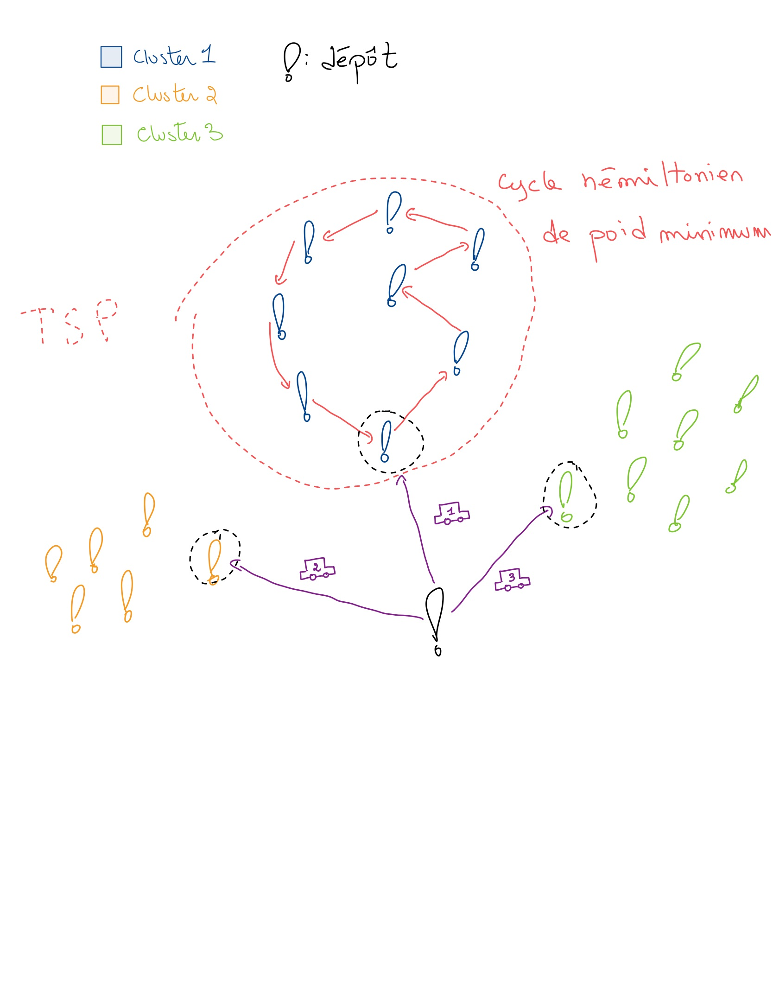

## Rapport - front  

### Récupération de la matrice temps/distance
Pour récupérer des matrice de plus que 50x50:
- on découpe la matrice principale en sous-matrice de 50x50,
- on récupère chaque sous-matrice avec une requête,
- on insère les nouvelles données dans la matrice principale dès qu'on les récupère,
- on attends pour une durée de $\frac{1}{40}$ minutes* entre chaque requête, pour éviter d'atteindre la limite d'ORS

*Dans les faits, on attend pour un durée de $\frac{2}{40}$ minutes bien que la limite théorique soit de 40 requêtes par minutes, car après avoir essayer 60s, 70s et même 90s, on continuait de recevoir des messages d'erreurs TooManyRequests. Bien que l'on ai toujours pas trouvé la raison exacte, on a au moins remarqué que cette durée était suffisant pour ne pas en recevoir.

### Algorithmes Clustering :  
En premier temps, on a identifié 2 algorithmes :  
- [K-means](https://www.google.com/url?sa=t&source=web&rct=j&opi=89978449&url=https://en.wikipedia.org/wiki/K-means_clustering&ved=2ahUKEwi1zveX1tKSAxX2h_0HHV5fNCwQFnoECAwQAQ&usg=AOvVaw0m6KGw2Jw5-TR7ZAglA51e)  
- [DBSCAN](https://www.google.com/url?sa=t&source=web&rct=j&opi=89978449&url=https://en.wikipedia.org/wiki/DBSCAN&ved=2ahUKEwjk582j1tKSAxUdg_0HHdQIJmYQFnoECB0QAQ&usg=AOvVaw3118ObckmqXq_m2Kl_jWtW) (Density-Based Spacial Clustering of Application with Noise)  

Finalement, après avoir essayé une biblio pour le k-means, celle-ci ne marchait pas de plus, on s'est apperçu qu'en faite les centres des clusters du *k-means* n'étaient pas des points (adresses) des addresses en entrée mais plutôt un centre calculé à partir de ces dernières.  

Après recherche, on a trouvé une variante de l'algorithme : le [K-medoids](https://www.geeksforgeeks.org/machine-learning/k-means-vs-k-medoids-clustering/), elle diffère du k-means par le fait que le centre des clusters est un des points du cluster à différence du k-means.  

En fin on a trouvé une biblio,testé et cette dernière marche bien :p .

### Optimisation des routes/trajets :  

#### - Première algo :  

Pour l'optimisation des routes, on procède de la manière suivante :
1. On groupe les adresses en clusters (un par véhicule) en se basant sur la matrice des distances, en suite on optimise le trajet de chaque voiture pour son cluster.
2. Pour l'optimisation du trajet d'un cluster, on cherche un cycle hamiltonien de poids minimum, en utilisant la matrice des distances, en partant du point du cluster le plus proche du dépôt, et en fin on retourne au dépôt.

