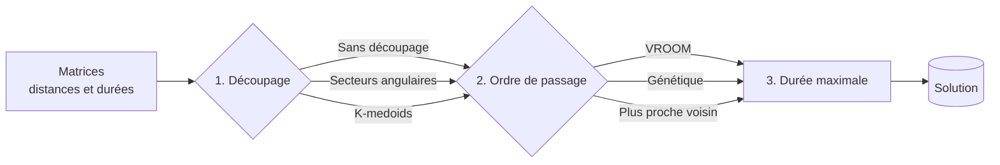

# Algorithmes

Ce document décrit les algorithmes qui construisent les tournées, tels qu'ils sont codés, avec
leurs paramètres réels.

## Le problème

Il faut répartir *n* livraisons entre *k* véhicules partant d'un même dépôt et y revenant, en
parcourant le moins de distance possible et sans dépasser une durée maximale par tournée.
C'est un **problème de tournées de véhicules** (VRP, *Vehicle Routing Problem*). Il est
NP-difficile : on ne peut pas essayer toutes les solutions dès que *n* dépasse quelques dizaines.

L'application le découpe donc en deux sous-problèmes plus simples, puis compare plusieurs façons
de les résoudre :

| Étape | Algorithmes | Code |
|---|---|---|
| Matrices | OpenRouteService, ou estimation à vol d'oiseau | [`DistanceMatrixService`](../backend/server/src/main/java/fr/uga/miage/l3/services/core/DistanceMatrixService.java), [`EstimatedMatrix`](../backend/server/src/main/java/fr/uga/miage/l3/services/core/EstimatedMatrix.java) |
| 1. Découpage | Sans découpage, secteurs angulaires, K-medoids | [`services/core/separation`](../backend/server/src/main/java/fr/uga/miage/l3/services/core/separation/) |
| 2. Ordre de passage | VROOM, algorithme génétique, plus proche voisin | [`services/optimisation/routing`](../backend/server/src/main/java/fr/uga/miage/l3/services/optimisation/routing/), [`services/core/optimization`](../backend/server/src/main/java/fr/uga/miage/l3/services/core/optimization/) |
| 3. Contrainte | Retrait des commandes les plus récentes | [`MaxDurationConstraint`](../backend/server/src/main/java/fr/uga/miage/l3/services/optimisation/MaxDurationConstraint.java) |

## Les données d'entrée : les matrices

Tous les algorithmes travaillent sur deux matrices carrées de taille *n* + 1, les livraisons
puis le dépôt en dernière position :

- `distance[i][j]` : mètres par la route de *i* à *j* ;
- `durée[i][j]` : secondes de conduite de *i* à *j*.

**Avec une clé OpenRouteService**, les matrices viennent de l'API *Matrix* d'ORS :

- ORS limite la taille d'une requête : on découpe en blocs de 50 × 50 points et on recolle les
  blocs. 120 points demandent ainsi 3 × 3 = 9 appels ;
- le débit est plafonné à 35 appels par minute (Resilience4j) ;
- un appel en échec est réessayé jusqu'à 5 fois, avec un délai qui double (0,5 s, 1 s, 2 s…).
  Sur une erreur 429, on attend le délai `Retry-After` indiqué par ORS.

**Sans clé** (mode estimation), les matrices sont calculées localement :

- distance = formule de **haversine** (distance à vol d'oiseau sur la sphère terrestre)
  × 1,3, car en ville on parcourt environ 30 % de plus qu'à vol d'oiseau ;
- durée = distance ÷ 30 km/h, une vitesse moyenne urbaine.

C'est moins précis, mais assez juste pour comparer des stratégies entre elles.

## 1. Découpage : un groupe par véhicule

### Sans découpage

Toutes les livraisons forment un seul groupe. Le moteur d'itinéraire reçoit *k* véhicules et
répartit lui-même, ce que seul VROOM sait faire. Pattern utilisé : **Null Object** : « pas de
découpage » est une stratégie comme les autres, ce qui évite des `if` dans le pipeline.

### Secteurs angulaires

On découpe le plan autour du dépôt comme les parts d'un gâteau :

1. pour chaque livraison, on calcule l'angle θ = `atan2(Δlat, Δlng)` par rapport au dépôt,
   ramené entre 0° et 360° ;
2. on trie les livraisons par angle ;
3. on coupe la liste en *k* paquets consécutifs de ⌈*n* / *k*⌉ livraisons.

- **Avantage** : très rapide (tri en O(*n* log *n*)), tournées de tailles équilibrées, qui ne se
  croisent pas.
- **Limite** : un quartier dense peut être coupé en deux si une frontière de secteur le traverse.
  Les distances routières ne sont pas utilisées.

### K-medoids

On forme *k* groupes de livraisons proches, chacun organisé autour d'un **medoid** : une
livraison réelle qui sert de centre au groupe.

1. **Initialisation.** Le premier medoid est tiré au hasard parmi les livraisons. Chaque medoid
   suivant est la livraison la plus éloignée des medoids déjà choisis (« point le plus lointain »).
   Les centres de départ sont ainsi bien répartis.
2. **Affectation.** Chaque livraison rejoint le medoid le plus proche, selon la matrice des
   distances routières.
3. **Mise à jour.** Dans chaque groupe, le nouveau medoid est la livraison dont la somme des
   distances aux autres membres est la plus petite.
4. On répète les étapes 2 et 3 tant que les medoids changent, avec 50 itérations au plus.

Le nombre de groupes vaut au plus le nombre de livraisons. Un groupe vide est supprimé.

**Pourquoi des medoids plutôt que K-means ?** K-means place ses centres en des points moyens qui
n'existent pas, et suppose une distance euclidienne. K-medoids n'a besoin que de la matrice des
distances : il fonctionne donc avec les vraies distances routières, et une rivière ou une
autoroute est bien prise en compte. Chaque itération coûte O(*n*²) au pire, à cause de la mise à
jour des medoids.

## 2. Ordre de passage dans chaque groupe

### VROOM

[VROOM](https://github.com/VROOM-Project/vroom) est un solveur open source de problèmes de
tournées, exposé par OpenRouteService (endpoint `/optimization`). On lui envoie :

- les **véhicules** : départ et retour au dépôt, profil `driving-car` et `max_travel_time`
  égal à la durée maximale demandée ;
- les **tâches** : position de chaque livraison et temps de service égal à son temps de montage.

VROOM construit des tournées par des heuristiques d'insertion, puis les améliore par recherche
locale. Il gère nativement plusieurs véhicules et la contrainte de temps : c'est le seul moteur
utilisé « sans découpage » avec plusieurs véhicules. Après un découpage, il reçoit un seul
véhicule par groupe.

Il n'est pas disponible en mode estimation, car il a besoin d'ORS.

### Algorithme génétique

L'algorithme imite une sélection naturelle sur des ordres de passage, avec la bibliothèque
[Jenetics](https://jenetics.io/).

| Élément | Choix |
|---|---|
| Individu | Une permutation des livraisons du groupe (un ordre de passage) |
| Note (*fitness*) | 1 / (distance totale dépôt → livraisons → dépôt + 0,001), à maximiser |
| Population | 100 individus tirés au hasard |
| Générations | 1 000 |
| Sélection | Tournoi de 2 : on garde le meilleur de deux individus tirés au hasard |
| Croisement | Probabilité 0,5, sur des paires voisines |
| Mutation | Probabilité 0,1 : *n* / 2 échanges de deux livraisons au hasard |

**Le croisement** doit produire une permutation valide : chaque livraison une seule fois.

1. Il choisit au hasard quel parent est « gardé », puis s'il garde ses positions paires ou
   impaires.
2. L'enfant reprend ces positions du parent gardé.
3. Il remplit les trous avec les livraisons manquantes, dans l'ordre où elles apparaissent chez
   l'autre parent.

Exemple : avec `0 1 2 3` et `3 2 1 0`, si l'on garde les positions impaires du premier parent,
l'enfant vaut `_ 1 _ 3`. On le complète avec 2 puis 0 (l'ordre du second parent) : `2 1 0 3`.

**La mutation** par échanges garde elle aussi une permutation valide. Le `+ 0,001` de la note
évite une division par zéro quand toutes les livraisons sont au même endroit.

Le coût est d'environ 100 × 1 000 évaluations de O(*n*), de l'ordre de la seconde par groupe.
L'algorithme trouve souvent de bons ordres sans garantie d'optimum. Les tests vérifient qu'il
trouve le tour optimal sur un petit carré.

### Plus proche voisin (glouton)

L'heuristique la plus simple :

1. partir du dépôt ;
2. aller à la livraison non visitée la plus proche, selon la matrice des distances ;
3. recommencer jusqu'à ce que tout soit visité, puis rentrer au dépôt.

- **Avantage** : instantané (O(*n*²)), déterministe, souvent à 20-25 % de l'optimum.
- **Limite** : il prend toujours le plus proche, sans anticiper. La fin de tournée comporte
  souvent un long retour.

## 3. Contrainte de durée maximale

Une fois les tournées calculées, on vérifie chacune :

> durée = Σ trajets (dépôt → … → dépôt) + Σ temps de montage

Tant que la durée dépasse le maximum, on retire de la tournée la livraison dont la **date de
commande est la plus récente**. Les clients qui attendent depuis le plus longtemps restent ainsi
prioritaires. Les livraisons retirées restent « à livrer » pour une prochaine optimisation. Une
tournée devenue vide est supprimée.

## Combien de solutions ?

Le pipeline essaie toutes les combinaisons découpage × moteur × nombre de véhicules (de *k* à 1),
sauf celles qui n'ont pas de sens :

- un découpage n'a pas d'intérêt avec un seul véhicule ;
- sans découpage, seul VROOM sait répartir entre plusieurs véhicules.

| Mode | Formule | 1 véhicule | 3 véhicules | 5 véhicules |
|---|---|---|---|---|
| Avec clé ORS | 7*k* − 4 | 3 | 17 | 31 |
| Mode estimation (sans VROOM) | 4*k* − 2 | 2 | 10 | 18 |

Chaque combinaison est une tâche indépendante, exécutée en parallèle sur un pool de threads
dédié. Les solutions arrivent dans l'interface au fil du calcul.

## Statistiques et coûts d'une tournée

| Grandeur | Calcul |
|---|---|
| Distance | Somme des distances de la matrice sur le parcours dépôt → … → dépôt |
| Temps de trajet | Même somme sur la matrice des durées |
| Carburant (mL) | distance (m) × consommation (L/100 km) ÷ 100. Consommation du véhicule affecté, 8 L/100 km par défaut |
| Coût carburant | litres × prix du litre (1,80 € par défaut) |
| Coût chauffeur | (trajet + montage) en heures × taux horaire du chauffeur (22 €/h par défaut) |
| Recette | nombre de livraisons × 9 € + poids total × 0,15 €/kg |
| Marge | recette − coût carburant − coût chauffeur |

Les valeurs par défaut se règlent dans `application.yml` (`app.couts`). Après une modification
manuelle d'une solution, distances et durées sont recalculées sur les vrais trajets, dans l'ordre
choisi par le planificateur.

## Pour aller plus loin

Pistes d'amélioration identifiées :

- **2-opt** après le glouton : inverser des segments de tournée tant que cela raccourcit le
  parcours. Gain typique de 5 à 10 %.
- **Capacité dans le découpage** : la charge utile n'est aujourd'hui vérifiée qu'à
  l'affectation d'un véhicule. On pourrait l'intégrer comme contrainte de K-medoids.
- **Graine aléatoire fixée** pour K-medoids et le génétique, afin de rendre deux optimisations
  identiques comparables.
