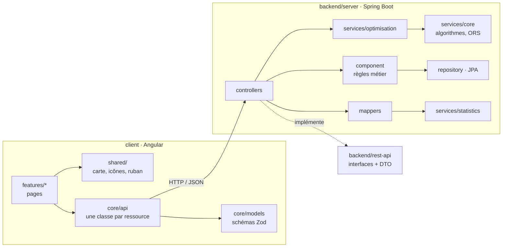
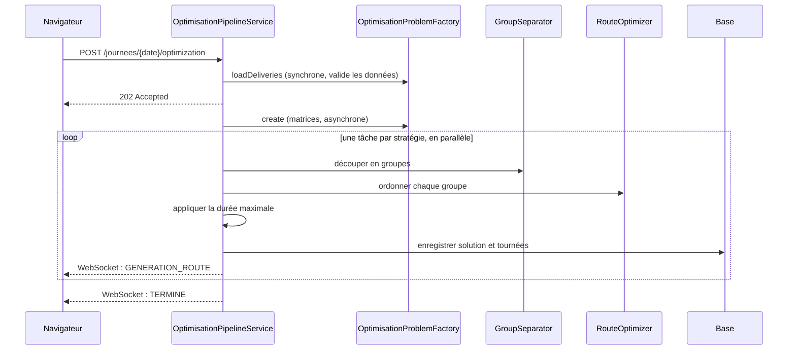
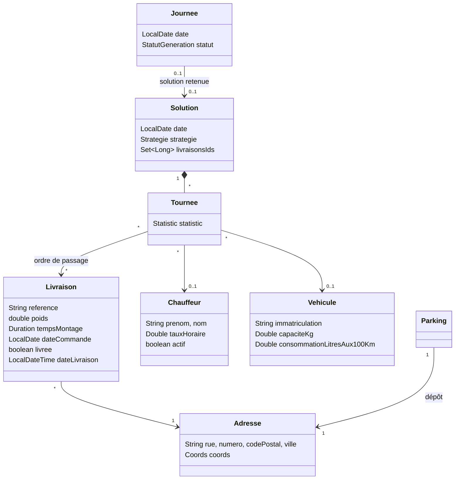

# Architecture

Ce document explique comment le code est organisé et pourquoi. Il s'adresse à un développeur
qui reprend le projet ou qui veut le relire.

## Vue d'ensemble



### Le module `rest-api`

Il ne contient que des **contrats** : les interfaces des endpoints, annotées Spring Web et
OpenAPI, et les DTO, des `record` immuables. Les contrôleurs de `server` implémentent ces
interfaces. Résultat :

- l'API publique se lit dans un seul module, sans logique autour ;
- un DTO modifié casse la compilation à tous les endroits concernés.

### Les couches du module `server`

| Paquet | Rôle | Ne fait pas |
|---|---|---|
| `controllers` | Lit la requête, appelle le métier, renvoie un DTO | Pas d'accès direct aux dépôts, pas de règle métier |
| `component` | Règles métier d'un agrégat : livraisons, tournées, solutions, équipe | Pas de HTTP, pas de DTO de réponse |
| `services/optimisation` | Orchestration d'une optimisation | Pas de persistance directe |
| `services/core` | Algorithmes purs et client OpenRouteService | Pas de dépendance à Spring Web |
| `services/statistics` | Statistiques et bilan financier d'une tournée ou d'une solution | — |
| `mappers` | Entités ↔ DTO (MapStruct, ou écrits à la main quand un calcul est nécessaire) | — |
| `exceptions` | Exceptions métier traduites en codes HTTP par `PIExceptionHandler` | — |

Les services lèvent des exceptions **métier** : `ResourceNotFoundException`,
`InvalidRequestException` et `ConflictException`. Seul le gestionnaire global les traduit en
404, 400 et 409. Le métier ne dépend donc pas du web. Une panne d'OpenRouteService devient une
502 avec un message lisible.

## Le pipeline d'optimisation



Quelques choix :

- **Validation avant la réponse 202.** Une demande sans livraison ni dépôt échoue tout de suite
  en 400 ou 404. Seul le calcul des matrices, qui est long, part en arrière-plan.
- **Futures chaînées sans `join()`.** Les tâches s'enchaînent avec `thenCompose` et `allOf`.
  Aucun thread n'en attend un autre, ce qui évite l'interblocage sur le pool dédié
  `optimisationExecutor`.
- **Une stratégie en échec n'arrête pas les autres.** Un quota ORS dépassé sur VROOM n'empêche
  pas les solutions génétiques et gloutonnes d'être enregistrées.
- **Un véhicule par groupe.** Quand les livraisons sont déjà découpées, VROOM reçoit un seul
  véhicule par groupe. Dans la version L3, chaque groupe recevait tous les véhicules.
- **Reprise après redémarrage.** Au démarrage, une optimisation restée « en cours » est marquée
  terminée. Sans cela, la journée resterait bloquée.

### Appels à OpenRouteService

`DistanceMatrixService` découpe les matrices en blocs de 50 × 50 points, ce qui respecte la
limite d'ORS. Resilience4j plafonne le débit à 35 appels par minute. Une erreur 429 est
réessayée après le délai `Retry-After`, sinon avec un délai exponentiel.

Sans clé et avec `app.ors.estimation-sans-cle: true` (réglage par défaut), `OrsMode` passe en
**mode estimation**. Les distances sont alors calculées à vol d'oiseau puis multipliées par
1,3, et les durées supposent 30 km/h de moyenne. Les tracés sont des lignes droites et VROOM
n'est pas proposé. L'application reste ainsi utilisable dès le clonage.

## Patterns de conception

| Pattern | Où | Pourquoi |
|---|---|---|
| **Strategy** | `SeparationStrategy` (secteurs angulaires, K-medoids, sans découpage) et `RouteOptimizer` (VROOM, génétique, glouton) | Ajouter un algorithme revient à ajouter un bean, sans toucher au pipeline |
| **Registry** | `GroupSeparator`, `RouteOptimizers` | Retrouve la bonne stratégie à partir de l'enum stockée en base |
| **Null Object** | `NoSeparationStrategy` | « Pas de découpage » est une stratégie comme les autres, donc pas de `if (separation == null)` |
| **Factory** | `OptimisationProblemFactory` | Construit en deux temps les données partagées par toutes les stratégies |
| **Adapter** | `OpenRouteServiceClient` | Seul point de contact avec l'API HTTP externe, facile à simuler dans les tests |
| **Facade** | `ApiClient` (front) | Préfixe `/api`, conversion en `Promise`, validation Zod au même endroit |
| **Immutable value** | `TourneesDraft` (front) | Chaque déplacement renvoie un nouveau brouillon, ce qui colle aux signals d'Angular et se teste sans DOM |

Refactorings appliqués sur le code de L3 :

- *Extract Class* : `RouteGenes` regroupe les conversions dupliquées entre croisement et
  mutation, et `MaxDurationConstraint` sort du service.
- *Replace Conditional with Polymorphism* : le `switch` sur le moteur d'optimisation est
  remplacé par des stratégies.
- *Introduce Parameter Object* : `OptimisationProblem` remplace sept paramètres passés de
  méthode en méthode.

## Modèle de données



Le **bilan financier** n'est pas stocké : il est recalculé à la lecture (`FinanceCalculator`).
Changer le prix du carburant dans la configuration met donc à jour toutes les solutions.
La quantité de carburant est stockée, car elle dépend de la distance et du véhicule affecté.

## Frontend

```text
client/src/app/
  core/api        une classe par ressource REST (LivraisonsApi, JourneesApi…)
  core/models     schémas Zod, miroir des DTO Java
  core/util       dates, durées, formats français, couleurs des tournées
  shared/         carte Leaflet, icônes, ruban de tournée, notifications, confirmation
  layout/         barre de navigation
  features/       une page par dossier : calendrier, journee, solution, livraisons, equipe, feuille-de-route
```

- **Composants standalone, signals et zoneless.** L'état vit dans des `signal`. Les paramètres
  d'URL arrivent en `input()` grâce à `withComponentInputBinding`.
- **Chargement à la demande.** Chaque page est un chunk séparé : la carte et le glisser-déposer
  ne pèsent que sur les pages qui s'en servent.
- **Validation à l'entrée.** Une réponse qui ne respecte pas son schéma Zod est rejetée tout de
  suite, au lieu de produire un `undefined` trois composants plus loin.
- **Design system maison.** Il tient dans `styles.scss` : tokens, boutons, champs, tableaux,
  dialogues natifs `<dialog>`. Il a remplacé Taiga UI, qui imposait son style et pesait
  l'essentiel du bundle.
- **Identité visuelle.** L'interface reste en gris neutre : la couleur est réservée aux
  tournées. Chaque véhicule a la sienne, reprise sur la carte, dans l'éditeur, sur le
  calendrier et sur la feuille de route. Le *ruban de tournée* (dépôt → arrêts → dépôt) en est
  la signature visuelle.

## Choix techniques

| Décision | Alternative écartée | Raison |
|---|---|---|
| Garder H2 pour les tests | Testcontainers PostgreSQL | Les tests tournent partout sans Docker ; le SQL utilisé reste portable |
| Bilan financier calculé à la lecture | Colonnes en base | Un changement de tarif s'applique partout, sans migration |
| `open-in-view` activé | DTO construits dans les transactions | Les mappers parcourent des relations paresseuses ; le volume de données reste faible |
| Seuil de couverture à 85 % des lignes | 100 % | À 100 %, on écrit des tests de getters. 85 % garde le filet sans pousser au remplissage |
| Recherche d'adresse côté navigateur (BAN) | Proxy backend | Service public, sans clé et ouvert au CORS : rien à protéger côté serveur |
