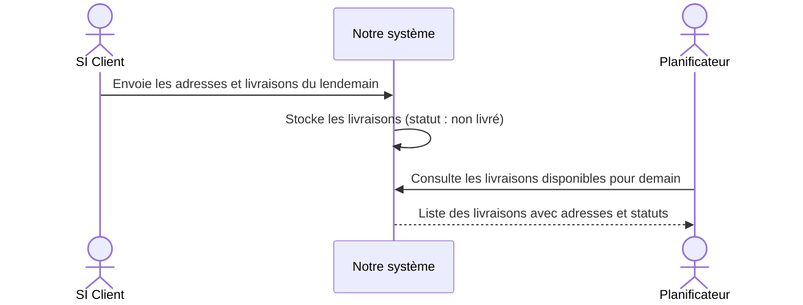
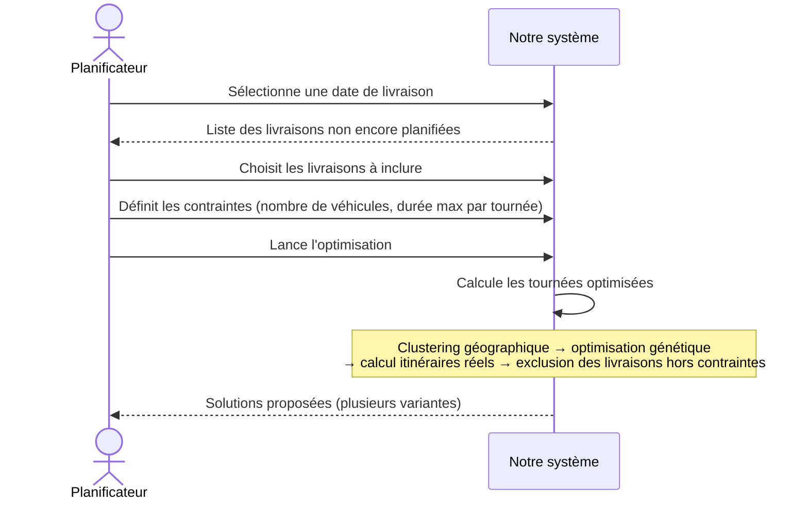
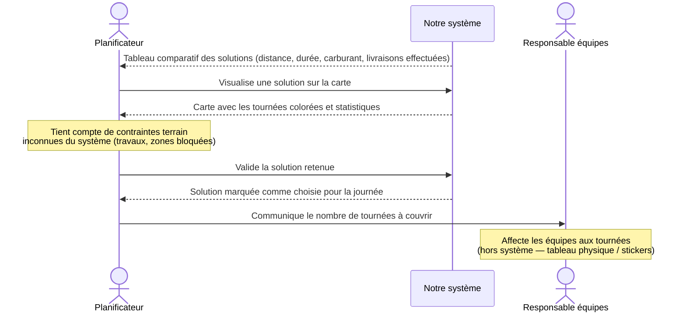
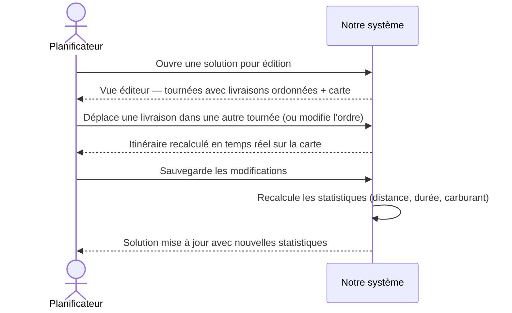
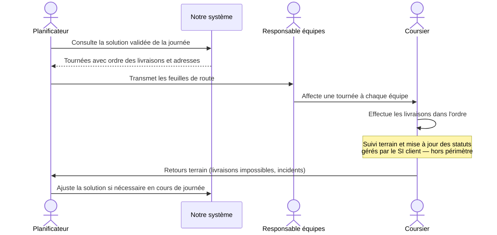
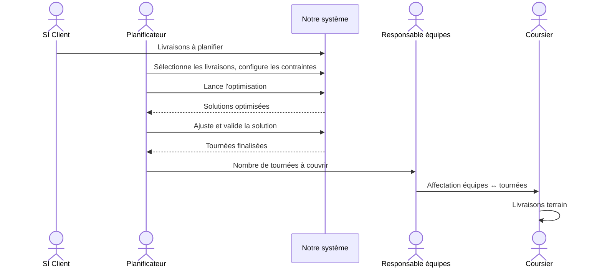

# Processus couverts par la solution

## Acteurs

| Acteur | Rôle |
|---|---|
| **Planificateur** | Prépare la journée de livraison du lendemain : sélectionne les livraisons, lance l'optimisation, valide la solution |
| **Responsable équipes** | Affecte les coursiers aux tournées (hors système — tableau physique) |
| **SI Client** | Système tiers qui gère les commandes ; nous envoie les livraisons à planifier |
| **Notre système** | CyberCommandes — calcule et optimise les tournées |
| **Coursier** | Effectue les livraisons sur le terrain (hors périmètre de notre système) |

---

## 1. Réception des livraisons depuis le SI client

Les livraisons à planifier arrivent du système de gestion des commandes du client. Notre système les stocke et les rend disponibles pour la planification.

---

## 2. Planification d'une journée de livraison

> Spec : [PlanifierUneJournée](https://github.com/L3-MIAGE-GRENOBLE/l3m-CyberCommandes-2025-2026/blob/master/(0)%20vision-globale/README.md#planifierunejournée-cas-composé) — [ConstruireUneJournée](https://github.com/L3-MIAGE-GRENOBLE/l3m-CyberCommandes-2025-2026/blob/master/(0)%20vision-globale/README.md#construireunejournée-sous-cas-de-planifierunejournée) — [OptimiserUneJournée](https://github.com/L3-MIAGE-GRENOBLE/l3m-CyberCommandes-2025-2026/blob/master/(0)%20vision-globale/README.md#optimiserunejournée-sous-cas-de-planifierunejournée)
> Scénarios : [PlanifierUneJournée-00](https://github.com/L3-MIAGE-GRENOBLE/l3m-CyberCommandes-2025-2026/blob/master/(1)%20scenarios-utilisateurs/PlanifierUeJourn%C3%A9e/PlanifierUneJourn%C3%A9e-00.md) · [01](https://github.com/L3-MIAGE-GRENOBLE/l3m-CyberCommandes-2025-2026/blob/master/(1)%20scenarios-utilisateurs/PlanifierUeJourn%C3%A9e/PlanifierUneJourn%C3%A9e-01.md) · [02](https://github.com/L3-MIAGE-GRENOBLE/l3m-CyberCommandes-2025-2026/blob/master/(1)%20scenarios-utilisateurs/PlanifierUeJourn%C3%A9e/PlanifierUneJourn%C3%A9e-02.md) · [03](https://github.com/L3-MIAGE-GRENOBLE/l3m-CyberCommandes-2025-2026/blob/master/(1)%20scenarios-utilisateurs/PlanifierUeJourn%C3%A9e/PlanifierUneJourn%C3%A9e-03.md)

Le planificateur sélectionne les livraisons à inclure, configure les contraintes et déclenche l'optimisation.

---

## 3. Comparaison et sélection d'une solution

> Spec : [VisualiserUneJournée](https://github.com/L3-MIAGE-GRENOBLE/l3m-CyberCommandes-2025-2026/blob/master/(0)%20vision-globale/README.md#visualiserunejournée-sous-cas-de-planifierunejournée)
> Scénarios : [PlanifierUneJournée-02](https://github.com/L3-MIAGE-GRENOBLE/l3m-CyberCommandes-2025-2026/blob/master/(1)%20scenarios-utilisateurs/PlanifierUeJourn%C3%A9e/PlanifierUneJourn%C3%A9e-02.md) · [03](https://github.com/L3-MIAGE-GRENOBLE/l3m-CyberCommandes-2025-2026/blob/master/(1)%20scenarios-utilisateurs/PlanifierUeJourn%C3%A9e/PlanifierUneJourn%C3%A9e-03.md) · [04](https://github.com/L3-MIAGE-GRENOBLE/l3m-CyberCommandes-2025-2026/blob/master/(1)%20scenarios-utilisateurs/PlanifierUeJourn%C3%A9e/PlanifierUneJourn%C3%A9e-04.md)

Le planificateur compare les solutions générées et sélectionne la plus adaptée à la réalité terrain.

---

## 4. Ajustement manuel d'une solution

> Spec : [AjusterUneJournée](https://github.com/L3-MIAGE-GRENOBLE/l3m-CyberCommandes-2025-2026/blob/master/(0)%20vision-globale/README.md#ajusterunejournée-sous-cas-de-planifierunejournée)
> Scénarios : [PlanifierUneJournée-02](https://github.com/L3-MIAGE-GRENOBLE/l3m-CyberCommandes-2025-2026/blob/master/(1)%20scenarios-utilisateurs/PlanifierUeJourn%C3%A9e/PlanifierUneJourn%C3%A9e-02.md) · [05](https://github.com/L3-MIAGE-GRENOBLE/l3m-CyberCommandes-2025-2026/blob/master/(1)%20scenarios-utilisateurs/PlanifierUeJourn%C3%A9e/PlanifierUneJourn%C3%A9e-05.md)

Après optimisation, le planificateur peut réorganiser les livraisons dans une tournée pour tenir compte de contraintes terrain.

---

## 5. Exécution des tournées *(hors périmètre — pour situer notre solution)*

> Spec : [EffectuerUneTournée](https://github.com/L3-MIAGE-GRENOBLE/l3m-CyberCommandes-2025-2026/blob/master/(0)%20vision-globale/README.md#effectuerunetournée-cas-composé) *(hors périmètre)*

Le déroulement terrain est géré hors de notre système. Ce processus illustre où s'arrête notre périmètre.

---

## Vue d'ensemble

